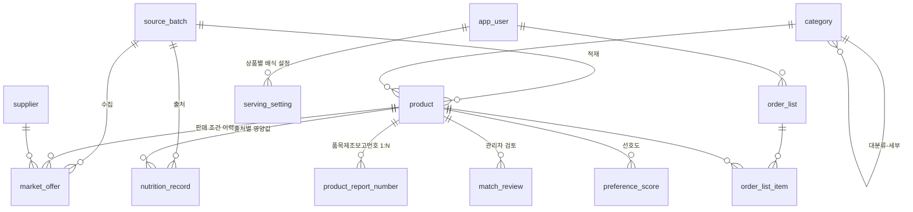

> 2026-10-23 경로 정리: 이 설계와 `scripts/load_postgres.py`는 최신 통합 앱과 함께 최상위에 보존했습니다. 아래 10월 19일 검증은 당시 별도 DB 작업 기록이며, 현재 앱 런타임이 PostgreSQL에 연결된다는 의미는 아닙니다. 이번 정리에서는 DB 적재를 실행하지 않았습니다.

# MiliMarket DB 설계 (PostgreSQL)

현재 앱은 `public/data/*.json`을 브라우저가 통째로 읽는 정적 구조입니다. 이 설계는 그 JSON 구조를 그대로 옮기면서, 계획서·회의록의 남은 요구사항(구매 목록 저장, 관리자 검토, 선호도, 자동 갱신)을 받을 수 있도록 테이블을 나눈 것입니다.

## 설계 원칙

1. **원본과 채택값 분리**: 출처별 값(OCR 원문, 식약처 DB 적용값, API 값, 수동 입력)은 각각 행으로 남기고, 화면에는 `adopted` 1건만 씁니다.
2. **모르는 값은 NULL**: 가격·중량·영양값을 0이나 추정값으로 채우지 않습니다(현재 앱 규칙과 동일).
3. **수집 이력 보존**: 엑셀 가져오기와 나라장터 수집 1회가 `source_batch` 1행입니다. 가격은 덮어쓰지 않고 쌓이므로 가격 이력과 출처·조회일을 그대로 보여줄 수 있습니다.
4. **저장 시점 스냅샷**: 구매 목록은 저장 당시 단가·출처·수집일을 함께 저장해, 이후 가격이 바뀌어도 검토 근거가 남습니다.

## ERD



## 테이블과 현재 코드의 대응

| 테이블 | 역할 | 현재 위치 |
|---|---|---|
| `source_batch` | 엑셀·수집·API 적재 이력, 파일 SHA-256 | `catalog-meta.json`, `market-summary.json` |
| `category` | 대분류 → 세부 식품유형 2단계 | `Product.category`, `subcategory` |
| `product` | 물품식별번호 기준 상품 마스터 | `products.json` |
| `product_report_number` | 한 셀의 복수 품목제조보고번호를 분리, 숫자만 남긴 매칭 키 | `Product.reportNumber` (문자열 1개) |
| `nutrition_record` | OCR 원문 / DB 적용값 / API / 수동 입력을 출처별로, 기준량 포함 | `rawNutrition`, `protein` 등 |
| `supplier`, `market_offer` | 나라장터 판매 조건, 수집 회차별 가격 이력 | `market-enrichment.json`, `shop-observations.json` |
| `current_offer` (뷰) | 최신 수집분 중 계약 유효·최저가 1건 (`build_market.py` 규칙과 동일) | `build_market.py` |
| `match_review` | 번호 매칭·나라장터 연결·영양값 등의 승인/보류 이력 | 없음 (관리자 화면 설계만 있음) |
| `preference_score` | 급양대 조사·품평회·시중 리뷰, **가상 데이터는 `is_synthetic=true` 필수** | 없음 |
| `app_user`, `serving_setting` | 사용자, 상품별 배식 설정 | `localStorage` (`order-preferences.ts`) |
| `order_list`, `order_list_item` | 구매 목록 저장, 단가·출처 스냅샷 | CSV 내보내기만 있음 |
| `product_card` (뷰) | 화면 카드 1장에 필요한 값을 한 번에 조회 | `Product` + `MarketInfo` |

## 검색

PostgreSQL 기본 확장 `pg_trgm`으로 한글 부분 일치 검색을 합니다. `product.search_text`(식별번호·상품명·식품유형·원재료·보고번호)에 GIN 인덱스가 있어 현재 앱의 "공백 구분 AND 검색"을 그대로 옮길 수 있습니다.

```sql
SELECT * FROM product_card
WHERE id IN (SELECT id FROM product WHERE search_text ILIKE ALL (ARRAY['%바나나%','%우유%']));
```

`word_similarity`로 오타·띄어쓰기 차이를 잡는 유사도 정렬도 같은 인덱스로 처리합니다. 상품 7,902개 규모에서는 별도 검색엔진(Meilisearch) 없이 충분하다고 판단해 넣지 않았습니다. 실측 결과는 아래 검증 기록에 있습니다.

## 적재

```sh
pip install "psycopg[binary]"
createdb milimarket
psql -d milimarket -f db/schema.sql
DATABASE_URL=postgresql://사용자@localhost/milimarket python scripts/load_postgres.py
```

- 기존 JSON 파일은 읽기만 하고 변경하지 않습니다.
- 다시 실행해도 됩니다. 이미 적재한 파일(같은 SHA-256)은 건너뛰고, 상품은 갱신하고, 새 수집 파일은 새 회차로 쌓습니다.
- 카탈로그에서 빠진 상품은 삭제하지 않고 `is_active=false`로 숨깁니다(저장된 구매 목록이 참조할 수 있음).
- 사람이 입력(`manual`)하거나 승인(`approved`)한 영양값은 엑셀을 다시 적재해도 채택값이 바뀌지 않습니다.

## 검증 기록 (2026-10-19, PostgreSQL 16, 실제 프로젝트 데이터)

- 적재 결과: 상품 7,902개, 나라장터 연결 7,673개, 채택 영양값 1,623개, 대분류별 건수가 `catalog-meta.json`과 일치했습니다.
- 품목제조보고번호: 7,050개 상품에서 번호 7,420개를 분리했고, 그중 467개는 공장 표기(F1/P1 등)가 있습니다.
- 재실행 시 중복 적재가 없었고, 새 수집 회차에서는 최신 가격으로 바뀌었습니다. 새 회차에 빠진 상품은 이전 수집분과 그 수집일로 남았습니다.
- 제약조건 위반 입력(중량 0, 인원 0, 가상 여부 누락, 채택값 2건, 배식량 없는 중량 계산)은 모두 거부됐습니다.
- 검색 시간: `족발` 86건 63ms, `바나나 우유` AND 11건 59ms, `돼지고기 냉동` 631건 23ms, 유사도 검색 1.5ms.

## 데이터에서 발견한 문제

- **계약 만료 가격**: `market-enrichment.json`은 9월 29일 생성 시점 기준이라, 그 뒤 계약이 끝난 61개 상품도 화면과 계산기에 단가가 그대로 쓰입니다(상세 화면에 계약종료일만 표시). `current_offer` 뷰는 조회일 기준으로 판정하므로 해당 상품은 단가 NULL로 나옵니다.
- **보고번호 칸 오염**: 물품식별번호 `25550081`의 품목제조보고번호 칸에 AI 응답 문장("저는 언어 모델일 뿐이라…")이 들어 있고, `24289839`는 "표기"만 있습니다. 원본 엑셀 정리 과정에서 생긴 것으로 보이며, 이 두 건은 번호 테이블에 들어가지 않습니다.
